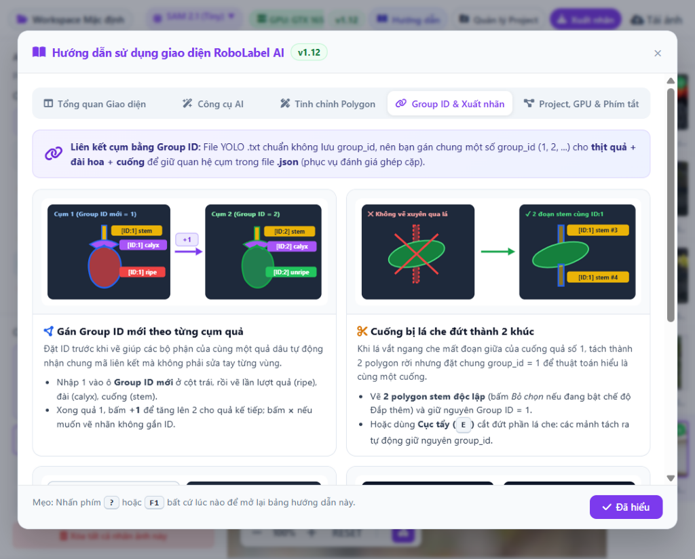
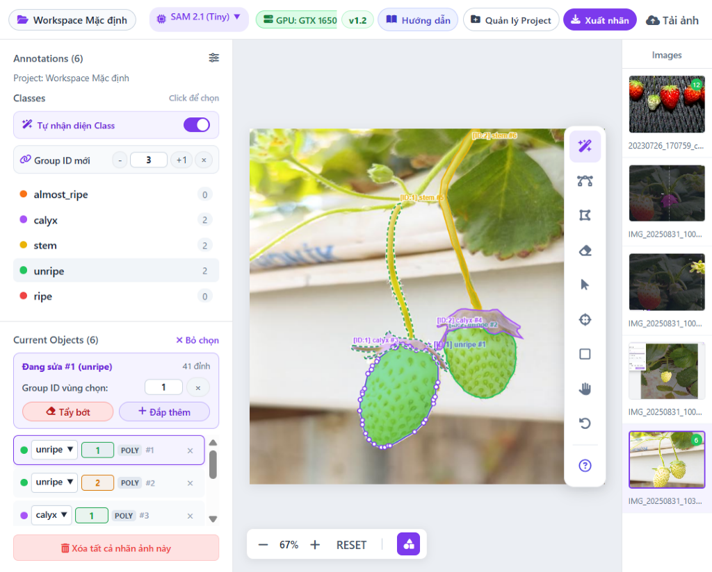

# RoboLabel AI — Studio Gán Nhãn & Phân Đoạn Ảnh Tự Động Cho YOLO


%20%26%20Labelme%20(.json)-10b981?style=flat-square)


> **Phiên bản hiện tại:** `v1.51` — Bổ sung hộp thoại **Cài đặt & Tùy chỉnh Phím tắt (`K`)**, phím tắt chuyển nhanh giữa **Classes (`↑`/`↓`)**, **Nhãn (`, `/`.`)**, **Ảnh (`←`/`→`)** và **Thu nhỏ / Phóng to / Đặt lại (`-` / `=` / `R`)**.

---

## Giới thiệu dự án

**RoboLabel AI** là studio gán nhãn dữ liệu thị giác máy tính chạy **cục bộ 100% (offline)** trên nền tảng Flask + HTML5 Canvas, thiết kế cho bài toán **YOLO Instance Segmentation (Polygon)** và **YOLO Object Detection (Bounding Box)**.

Công cụ giúp rút ngắn tối đa thời gian vẽ thủ công khi cần gán nhãn các vật thể đa bộ phận — đặc biệt phù hợp cho dữ liệu nông nghiệp/robot thu hoạch (ví dụ cụm quả dâu tây gồm thịt quả `unripe`, `almost_ripe`, `ripe`, đài hoa `calyx` và cuống `stem`) cũng như mọi bộ dữ liệu phân đoạn tùy chỉnh khác.

### Tính năng cốt lõi

| Nhóm chức năng | Mô tả chi tiết |
| :--- | :--- |
| **Phân đoạn AI tức thì** | Tích hợp **SAM 2.1 (Tiny & Large)** qua **AI Smart Box (`S`)**, **AI Lasso** (khoanh tự do khi nhiều vật thể dính nhau) và **AI Point** — tự tách đường viền mượt, lọc nhiễu đảo nhỏ. |
| **Tự nhận diện Class** | Bật **CLIP ViT-B/32** để tự phân tích vùng vừa tách và gán tên lớp phù hợp (hoặc tắt để gán thủ công theo class đang chọn). |
| **Tinh chỉnh Polygon mượt** | **Cục tẩy (`E`)** gọt viền và giữ nguyên `group_id` khi cắt rời mảnh bị che; **Đắp thêm / Vẽ tay (`P`)** tự gộp Union; **Kéo đỉnh (`V`)**; **Hoàn tác (`Ctrl + Z`)** tối đa 30 bước. |
| **Phát hiện & Tự sửa trùng nhãn (`Auto-fix`)** | Tự động phát hiện các cặp polygon giao nhau `> 2 px²` (vẫn cho phép chạm viền), hiện cảnh báo nổi bật kèm icon cảnh báo ở sidebar, và cắt trừ bằng **Shapely** theo ưu tiên `calyx > stem > quả > vẽ sau`, giữ nguyên `group_id` & `label` khi tách `MultiPolygon`. |
| **Gán `Group ID` theo cụm** | Gắn ID nhóm trước khi vẽ (`-` / `+1` / `×`) hoặc sửa trực tiếp từng dòng để liên kết quả–đài–cuống (kể cả cuống bị lá che đứt 2 đoạn), tô viền đứt nét đồng bộ để kiểm tra nhầm cụm. |
| **Xuất `.txt` & `.json` tùy chọn** | Xuất **YOLO `.txt`** (tọa độ chuẩn hóa `[0, 1]`, tự lược bỏ `group_id`), **Labelme / X-AnyLabeling `.json`** (pixel tuyệt đối, giữ `group_id`), hoặc **cả hai**, chọn cấu trúc `train/val` hoặc thư mục phẳng, hỗ trợ preset `Chuẩn 5 lớp`. |
| **Quản lý Project & Auto-Save** | Tạo nhiều Project độc lập (kéo thả thư mục hoặc chọn từ ổ đĩa), tự nhận diện dataset ảnh thuần / YOLO Box / YOLO Seg, đồng bộ Auto-Save liên tục. |
| **Điều phối GPU CUDA / CPU** | Tự dò GPU NVIDIA (`cu126` / `cu124`), chuyển đổi linh hoạt GPU/CPU ngay trên Header, tự lùi về CPU khi tràn VRAM và tích hợp **Benchmark GPU**. |

### Điểm mới nổi bật trong phiên bản `v1.51`

- **Cài đặt & Tùy chỉnh Phím tắt (`K`):** Nút **`Phím tắt`** trên Header mở hộp thoại tùy biến toàn bộ phím cho công cụ vẽ, điều hướng và thao tác; hỗ trợ nhận phím khi đang bật bộ gõ tiếng Việt, tự hoán đổi khi trùng phím và lưu tự động trên trình duyệt.
- **Chuyển nhanh Nhãn, Classes, Ảnh & Phóng to/Thu nhỏ:**
  - **`↑` / `↓`** (hoặc 2 nút cạnh mục `Classes`): chuyển qua lại giữa các **Classes** (tự đổi Class nếu đang chọn 1 nhãn).
  - **`,` / `.`** (hoặc 2 nút cạnh mục `Current Objects`): chuyển tới nhãn trước/tiếp theo trên ảnh và tự cuộn danh sách.
  - **`←` / `→`**: chuyển ảnh trước/sau; **`-` / `=` (`+`) / `R`**: thu nhỏ, phóng to hoặc đặt lại tỷ lệ vừa khung.

### Điểm mới nổi bật trong phiên bản `v1.5`

- **2 nút xóa toàn bộ `Group ID` ở Sidebar trái (vẫn giữ nguyên nhãn):**
  - **`Xóa ID ảnh này`:** Gỡ toàn bộ `group_id` của ảnh đang mở (giữ nguyên toàn bộ polygon/bbox và class, hỗ trợ `Ctrl + Z` hoàn tác nếu bấm nhầm).
  - **`Xóa ID toàn Project`:** Dọn sạch `group_id` trên tất cả ảnh thuộc project đang hoạt động qua API `/api/clear_project_group_ids`, giữ nguyên 100% nhãn đối tượng và đồng bộ Auto-Save.
- **Popover nhập nhanh `Group ID` trực tiếp trên Canvas:** Khi chọn một vùng nhãn trên ảnh, ô nhập nhanh `Group ID` hiện ngay cạnh vị trí chuột (hoặc nhấn thẳng phím số `0–9` rồi `Enter` để gán tức thì; `Esc` để hủy).

### Điểm mới nổi bật trong phiên bản `v1.42`

- **Kéo căn chỉnh tỷ lệ bảng `Classes` và `Current Objects`:** Kéo thanh ngăn ngang ở sidebar trái (hoặc dùng phím `↑` / `↓`, double-click để đặt lại mặc định) để mở rộng hoặc thu gọn từng danh sách, giữ giới hạn an toàn cho cả hai bảng và tự lưu độ cao vào trình duyệt.
- **Tự động cuộn tới nhãn đang chọn trong `Current Objects`:** Khi bấm chọn một vùng đã gán nhãn trên ảnh (bằng công cụ Chọn `V` hoặc Cục tẩy `E`), danh sách `Current Objects` tự động cuộn mượt đến đúng dòng nhãn tương ứng và nháy sáng nổi bật để không phải lăn chuột tìm thủ công.
- **Thanh Header tự thích ứng cửa sổ hẹp (`<= 1080px`):** Tự xuống 2 hàng gọn gàng trên màn hình kích thước nhỏ, giữ hiển thị đầy đủ trạng thái Auto-Save, chọn mô hình SAM và nút `GPU / CPU` không bị cắt xén.

### Điểm mới nổi bật trong phiên bản `v1.41`

- **Vẽ Đường Bao Tự Do theo chuyển động chuột (`F`):** Chọn biểu tượng cây bút hoặc nhấn phím **`F`**, giữ chuột trái di chuyển dọc theo viền vật thể; nét vẽ bám theo con trỏ chuột kèm đường nét đứt xem trước điểm nối về gốc, và khi nhả chuột hệ thống tự động nối khép kín thành Polygon (lọc bớt đỉnh nhiễu bằng Ramer-Douglas-Peucker, giữ `Group ID` và tự lưu ngay).

### Điểm mới nổi bật trong phiên bản `v1.4`

- **Loại bỏ nhanh ảnh không đạt bằng nút `×` (xóa cả ảnh, `.txt` và `.json`):** Ở cột danh sách ảnh bên phải (`Images`), bấm dấu `×` ở góc trên bên phải thumbnail để xóa ngay ảnh bị lỗi cùng toàn bộ file `.txt` và `.json` tương ứng trong project mà không làm gián đoạn bằng hộp thoại xác nhận.
- **Khôi phục an toàn bằng `Ctrl + Z`:** Nếu bấm nhầm `×`, phần mềm giữ bản sao lưu tạm trong phiên (tối đa 20 ảnh gần nhất) để bạn nhấn `Ctrl + Z` khôi phục lại nguyên vẹn ảnh gốc, file `.txt`, file `.json` và vị trí split trong manifest.
- **Phông chữ nhãn trên Canvas nhỏ gọn & tự co giãn theo Zoom:** Nhãn đối tượng trên ảnh tự động thu nhỏ/phóng to tỷ lệ theo mức phóng to – thu nhỏ ảnh, giúp nhìn rõ viền polygon và đỉnh khi thao tác chi tiết.

### Điểm mới nổi bật trong phiên bản `v1.3`

- **Phát hiện lỗi vẽ đè Polygon (`> 2 pixel²`):** Tự động kiểm tra toàn bộ cặp polygon khi mở ảnh hoặc ngay sau khi vẽ/sửa, bỏ qua trường hợp chỉ chạm sát biên hoặc sai số làm tròn `<= 2 px²`.
- **Cảnh báo trực quan & Rà soát nhanh:** Hiển thị khung cảnh báo màu cam/đỏ ở góc trên vùng làm việc (ghi rõ cặp nhãn đè lên nhau, ví dụ `Phát hiện 1 vùng trùng: calyx đè lên ripe`), gắn icon cảnh báo cạnh tên ảnh ở sidebar phải và đánh dấu từng đối tượng trùng trong `Current Objects`.
- **Nút "Tự sửa" (`Auto-fix`) bằng Shapely Boolean Difference:** Cắt bỏ phần giao nhau khỏi đối tượng bị đè theo thứ tự ưu tiên giữ hình dạng (`calyx` > `stem` > thân quả `ripe`/`almost_ripe`/`unripe` > polygon vẽ sau), tự động tách `MultiPolygon` thành các polygon độc lập vẫn giữ nguyên `group_id` & `label`, đồng thời lưu file JSON ngay.
- **Thông báo điểm mới sau khi cập nhật:** Khi máy khác cập nhật bản mới qua `update.bat` và khởi động giao diện, popup giới thiệu bản cập nhật `v1.3` tự động hiển thị (có thể xem lại bằng cách bấm badge `v1.3` trên Header) cùng hướng dẫn trực quan trong tab **Tinh chỉnh & Tự sửa Trùng**.

### Điểm mới nổi bật trong phiên bản `v1.2`

- Bổ sung hệ thống gán **`Group ID` theo từng vùng/cụm** (hỗ trợ cả thao tác gắn trước khi vẽ lẫn sửa inline trong danh sách đối tượng và hiển thị viền đứt nét liên cụm).
- Thêm hộp thoại **Xuất nhãn tùy chọn (`.txt` / `.json` / `.zip`)** cho toàn bộ Project hoặc ảnh đang mở, kèm preset thứ tự lớp **`Chuẩn 5 lớp (0:unripe → 4:calyx)`** và bảo vệ ghi đè thư mục gốc.
- Làm mới modal **Hướng dẫn sử dụng 5 tab (`?` / `F1`)** ngay trong app và hoàn thiện bộ kiểm tra tự động `tests/self_check.py`.

### Mục lục nhanh

1. [Cấu hình Tối thiểu, Khuyến nghị & Yêu cầu phần mềm](#1-cấu-hình-tối-thiểu-khuyến-nghị--yêu-cầu-phần-mềm)
2. [Cài đặt, Khởi chạy & Cập nhật (`setup.bat`, `run_app.bat`, `update.bat`)](#2-cài-đặt-khởi-chạy--cập-nhật)
3. [Tổng quan giao diện làm việc](#3-tổng-quan-giao-diện-làm-việc)
4. [Hướng dẫn chi tiết từng bước sử dụng](#4-hướng-dẫn-chi-tiết-từng-bước-sử-dụng) • [Tự sửa lỗi vẽ đè (`Auto-fix`)](#44-tự-động-phát-hiện--sửa-lỗi-vẽ-đè-polygon-auto-fix) • [Đánh `Group ID` theo cụm](#46-hướng-dẫn-đánh-group-id-theo-từng-vùngcụm) • [Xuất `.txt` / `.json` tùy chọn](#47-auto-save--xuất-nhãn-tùy-chọn-txt--json)
5. [Cấu trúc thư mục dự án](#5-cấu-trúc-thư-mục-dự-án)
6. [Xử lý các lỗi thường gặp](#6-xử-lý-các-lỗi-thường-gặp)
7. [Đóng gói & Đẩy thay đổi lên GitHub](#7-đóng-gói--đẩy-thay-đổi-lên-github-dành-cho-người-phát-triển)

---

## 1. Cấu hình Tối thiểu, Khuyến nghị & Yêu cầu phần mềm

### 1.1. Bảng cấu hình phần cứng (đối chiếu theo dung lượng thực tế & ngưỡng VRAM)

| Thành phần | Cấu hình Tối thiểu (Chạy được bằng CPU) | Cấu hình Khuyến nghị (Chạy mượt với GPU CUDA) |
| :--- | :--- | :--- |
| **Hệ điều hành** | Windows 10 / 11 (64-bit) | Windows 10 / 11 (64-bit) |
| **CPU** | Intel / AMD 64-bit, tối thiểu **4 luồng** (`~1.5s/vật thể` với SAM 2.1 Tiny trên CPU) | Intel Core i5/i7 (thế hệ 10+) hoặc AMD Ryzen 5/7 (**6–8 nhân / 12–16 luồng trở lên**) |
| **RAM** | **8 GB RAM** | **16 GB RAM trở lên** *(thoải mái cho ảnh độ phân giải lớn + SAM + CLIP + trình duyệt)* |
| **GPU & VRAM** | Không bắt buộc GPU rời *(hệ thống tự dùng CPU và tự lùi về CPU nếu GPU tràn VRAM)* | - Dùng **SAM 2.1 Tiny + CLIP**: GPU NVIDIA CUDA **≥ 4 GB VRAM** *(như GTX 1650, `~0.05s/vật thể`)*<br>- Dùng **SAM 2.1 Large (chi tiết cao)**: GPU NVIDIA CUDA **≥ 6 GB – 8 GB VRAM** *(RTX 2060 / 3060+)* |
| **Ổ cứng trống** | **8 – 10 GB trống** *(đã đo thực tế `venv` CUDA ~4.6 GB + weights mặc định ~412 MB)* | **15 – 20 GB+ SSD** *(dư cho cả SAM 2.1 Large ~428 MB, nhiều project & thư mục Export)* |
| **Trình duyệt** | Google Chrome / Microsoft Edge bản mới *(hỗ trợ HTML5 Canvas & chọn thư mục)* | Google Chrome / Microsoft Edge bản mới |
| **Mạng Internet** | Cần khi cài đặt lần đầu (`setup.bat` tải ~2.45 GB PyTorch CUDA + ~412 MB weights + gói thư viện) & khi chạy `update.bat` | Sau khi cài xong, toàn bộ thao tác gán nhãn **chạy offline cục bộ** |

### 1.2. Tài nguyên của từng mô hình AI tích hợp

| Mô hình | Dung lượng trọng số (`weights\`) | Ngưỡng VRAM ước tính | Ghi chú lựa chọn |
| :--- | :--- | :--- | :--- |
| **SAM 2.1 (Tiny)** — *Mặc định* | `~74.5 MB` (`sam2.1_t.pt`) | `~1.300 MB` *(cần ~1.9 GB trống để chạy dư dả)* | Tốc độ rất nhanh trên cả GPU 4 GB và CPU; khuyên dùng hằng ngày |
| **CLIP (ViT-B/32)** — *Tự nhận diện Class* | `~337.6 MB` (`clip\ViT-B-32.pt`) | `~950 MB` | Chỉ dùng khi bật công tắc **Tự nhận diện Class** |
| **SAM 2.1 (Large)** — *Tùy chọn* | `~428.4 MB` (`sam2.1_l.pt`) | `~3.600 MB` *(tự tải khi chọn lần đầu)* | Chi tiết cao hơn; với GPU 4 GB không nên bật liên tục nếu mở thêm CLIP/app đồ họa khác |

### 1.3. Phần mềm cần chuẩn bị trước

- **Python:** **3.10 – 3.14** ([python.org/downloads](https://www.python.org/downloads/)).
  > **Lưu ý quan trọng khi cài Python:** Ở màn hình cài đặt đầu tiên, bắt buộc tích chọn **`Add python.exe to PATH`** trước khi bấm *Install Now*.
- **Git for Windows:** Cần để tải dự án và dùng chức năng cập nhật tự động `update.bat`.
  - Cài nhanh qua PowerShell/CMD: `winget install --id Git.Git -e --source winget`
  - Hoặc tải bộ cài tại: [git-scm.com/download/win](https://git-scm.com/download/win) (các bước cài có thể giữ mặc định **Next**).
- **Driver NVIDIA (nếu máy có GPU NVIDIA):** Cài sẵn driver NVIDIA hỗ trợ CUDA `12.6` (hoặc `12.4`) để `setup.bat` tự kích hoạt PyTorch CUDA (`cu126`, dự phòng `cu124`). Sau khi mở app, có thể bấm **GPU / CPU** → **Chạy Benchmark GPU** để tự đo tốc độ thực tế và kiểm tra VRAM.

---

## 2. Cài đặt, Khởi chạy & Cập nhật

### Bước 1: Tải mã nguồn về máy
Mở **Command Prompt (`cmd`)** hoặc **PowerShell** tại thư mục muốn lưu ứng dụng (ví dụ `D:\`) và chạy:

```cmd
git clone https://github.com/tocamban/robolable_ai.git
cd robolable_ai
```

> **Khuyến nghị:** Dùng `git clone` thay vì bấm *Download ZIP* trên GitHub để giữ sẵn thư mục `.git` cho `update.bat`. *(Nếu lỡ tải bản ZIP, xem Mục 6 để liên kết lại `.git` mà không mất `venv/` hay `weights/`.)*

### Bước 2: Chạy cài đặt tự động 1-click (`setup.bat`)
Nhấp đúp vào **`setup.bat`**. Script sẽ tự động:
1. Tạo môi trường ảo **`venv\`** tách biệt.
2. Kiểm tra GPU NVIDIA (`nvidia-smi`) để cài **PyTorch CUDA `cu126`** (dự phòng `cu124`) hoặc tự chọn **PyTorch bản CPU**.
3. Cài đặt thư viện từ `requirements.txt` (`Flask`, `Ultralytics`, `OpenCV`, `Pillow`, `Shapely`, `CLIP`, `psutil`, `nvidia-ml-py`,...).
4. Tải trọng số mặc định vào `weights\`: `sam2.1_t.pt` (~75 MB) và `clip\ViT-B-32.pt` (~338 MB).

Khi thấy thông báo **`CAI DAT HOAN TAT! BAN DA CO THE CHAY PROJECT!`**, nhấn phím bất kỳ để đóng.

### Bước 3: Điều khiển hằng ngày

| Thao tác | File thực thi | Mô tả chi tiết |
| :--- | :--- | :--- |
| **Khởi động app** | **`run_app.bat`** | Giải phóng port `5050` (nếu bị kẹt), khởi động server Flask và mở trình duyệt tại `http://127.0.0.1:5050`. *Giữ cửa sổ CMD mở trong suốt lúc làm việc để xem log AI.* |
| **Cập nhật bản mới** | **`update.bat`** | Tự tạm dừng port `5050`, kéo code mới từ GitHub (bảo toàn ảnh/project/`venv`/`weights`), tự cập nhật thư viện nếu `requirements.txt` thay đổi. |
| **Tắt server** | **`stop_server.bat`** | Dừng tiến trình trên port `5050` an toàn (hoặc bấm `Ctrl + C` trong cửa sổ terminal đang chạy). |

---

## 3. Tổng quan giao diện làm việc

Sau khi chạy `run_app.bat`, trình duyệt sẽ mở không gian làm việc chính gồm **4 khu vực**:


1. **Thanh Header (Phía trên):**
   - **Chọn Project:** Hiển thị Workspace / Project hiện tại (ví dụ `Workspace Mặc định`); click để mở nhanh danh sách Project.
   - **Chọn mô hình SAM:** Chuyển giữa **`SAM 2.1 (Tiny)`** (nhanh, khuyên dùng hằng ngày) và **`SAM 2.1 (Large)`** (viền chi tiết hơn).
   - **Nút `GPU / CPU`:** Xem thiết bị đang chạy (`GPU: GTX 165...` hoặc `CPU`), chuyển đổi CUDA/CPU và mở **Benchmark GPU**.
   - **Badge phiên bản (`v1.51`), nút `Phím tắt` (`K`) & `Hướng dẫn` (`?` / `F1`):** Xem điểm mới bản cập nhật (khi nhấn badge `v1.51`), mở hộp thoại tùy chỉnh phím tắt (`K`) hoặc bảng hướng dẫn minh họa 5 tab ngay trong ứng dụng.
   - **`Quản lý Project` / `Xuất nhãn` / `Tải ảnh`:** Tạo hoặc mở Dataset Project, xuất nhãn tùy chọn (`.txt` / `.json`), và thêm ảnh đơn lẻ.
2. **Cột trái (Classes & Current Objects):**
   - Công tắc **`Tự nhận diện Class`** (bật để CLIP tự đoán nhãn khi cắt bằng AI; tắt để gán đúng Class đang chọn thủ công).
   - Thanh **`Group ID mới`** (`-`, ô nhập số / `Trống`, `+1`, `×`) đặt ID nhóm mặc định cho các vùng sắp vẽ.
   - Danh sách **Classes** & thống kê số nhãn trên ảnh hiện tại.
   - Danh sách **`Current Objects`** kèm ô chỉnh nhanh **`ID`** trên từng dòng và bảng thao tác đối tượng đang chọn (**`Tẩy bớt`**, **`+ Đắp thêm`**, **`Group ID vùng chọn`**).
3. **Vùng Canvas trung tâm & Thanh công cụ dọc:**
   - Thanh công cụ bên phải Canvas: **AI Smart Box (`S`)**, **AI Lasso**, **Vẽ Polygon (`P`)**, **Vẽ Đường Bao Tự Do (`F`)**, **Cục Tẩy (`E`)**, **Chọn & Kéo đỉnh (`V`)**, **AI Point**, **Bounding Box**, **Pan (`H`)**, **Hoàn tác (`Ctrl + Z`)**, và mở **Phím tắt (`?`)**.
   - Thanh dưới cùng Canvas: Thu/phóng **`- / 100% / + / RESET`** và nút bật/tắt **Mask** phủ màu bán trong suốt.
4. **Cột trái (`Current Objects`) & Cột phải (`Images`):**
   - Danh sách `Current Objects` hiển thị từng vùng kèm đánh dấu cam nếu vùng đó đang tham gia lỗi trùng nhãn (rê chuột để xem chi tiết cặp đè và diện tích `px²`).
   - Dải thumbnail toàn bộ ảnh ở cột phải kèm huy hiệu số lượng nhãn và icon cảnh báo cam cạnh tên ảnh đang có lỗi trùng nhãn để dễ rà soát.

### Bảng Hướng dẫn trực quan tích hợp ngay trong app (`?` hoặc `F1`)

Bất kỳ lúc nào trong khi gán nhãn, bấm nút **`Hướng dẫn`** trên Header (hoặc phím **`?`** / **`F1`**) để mở hộp thoại 5 tab có sơ đồ minh họa từng thao tác (`Tổng quan`, `Công cụ AI`, `Sửa viền & Polygon`, `Group ID & Xuất nhãn`, `Quy trình & Phím tắt`):



---

## 4. Hướng dẫn chi tiết từng bước sử dụng

### 4.1. Tạo & Quản lý Dataset Project (Khuyên dùng)
Để không ghi đè lên thư mục ảnh gốc trên máy, nên tạo **Dataset Project** riêng:
1. **Cách 1 — Kéo thả trực tiếp:** Kéo cả thư mục chứa ảnh (hoặc Dataset YOLO Detection / Segmentation có sẵn nhãn) thả thẳng vào cửa sổ trình duyệt.
2. **Cách 2 — Qua nút `Quản lý Project`:** Chọn tab **Tạo Project Mới**, chọn thư mục nguồn từ ổ đĩa.
3. Hệ thống tự nhận diện loại dữ liệu (ảnh thuần / YOLO Box / YOLO Seg), cho phép chỉnh danh sách **Classes** (hoặc chọn bộ 5 lớp dâu tây mặc định: `almost_ripe`, `calyx`, `stem`, `unripe`, `ripe`), đặt **Tên Project** và **Thư mục lưu riêng**.
4. Dữ liệu được đồng bộ kèm file `robolabel_project.json` và **Auto-Save** mỗi khi vẽ, sửa hoặc gán `Group ID`.

### 4.2. Gán nhãn nhanh bằng AI (SAM 2.1 + CLIP)
- **AI Smart Box (`S`) — *Khuyên dùng*:** Giữ chuột trái kéo khung chữ nhật quanh vật thể → SAM 2.1 tự tách đường viền Polygon mượt (tự khử nhiễu, không nối bắc cầu các đảo nhỏ).
- **AI Lasso:** Giữ chuột khoanh vòng tự do quanh vật thể → hữu ích khi nhiều quả/lá nằm sát nhau, AI chỉ lấy mask bên trong vòng khoanh.
- **AI Point:** Click chọn Class ở cột trái (nếu tắt *Tự nhận diện Class*), sau đó click 1 điểm vào giữa vật thể để SAM tự khoanh viền.
- **Bounding Box thông thường:** Kéo khung chữ nhật YOLO Detection (4 đỉnh) không qua AI.

### 4.3. Vẽ thủ công & Tinh chỉnh viền Polygon
Khi AI tách bị lem ra ngoài hoặc cắt thiếu góc, bạn không cần xóa vẽ lại:
- **Cục Tẩy (`E`):** Chọn đối tượng cần sửa (click trực tiếp hoặc bấm **`Tẩy bớt`**), chỉnh kích thước đầu tẩy (`5px – 80px` bằng thanh trượt, nút `10 / 20 / 35 / 50px`, hoặc phím **`[`** / **`]`**) rồi giữ chuột trái quẹt gọt phần bị lem.
- **Vẽ Polygon Thủ Công / Đắp thêm (`P`):**
  - **Nếu ĐANG chọn sẵn 1 đối tượng** *(hiện nhãn Đắp thêm vào Object đang chọn)*: chấm các đỉnh bao vùng bị thiếu rồi đóng kín → hệ thống tự **gộp (Union)** vào polygon cũ.
  - **Nếu CHƯA chọn đối tượng nào** *(bấm `Bỏ chọn` nếu muốn tạo mới)*: click đặt từng đỉnh quanh vật thể, đưa chuột lại gần điểm đầu tiên (xuất hiện vòng xanh **Snap**) rồi nhấn **`Enter`** hoặc **Double-click** để khép kín. Nhấn **Chuột phải** / **`Backspace`** / **`Delete`** để xóa đỉnh vừa đặt; **`Esc`** để hủy.
- **Vẽ Đường Bao Tự Do (`F`):** Giữ chuột trái di chuyển liên tục dọc theo đường viền vật thể; nhả chuột để tự động nối điểm cuối về điểm đầu thành Polygon khép kín (nhấn **`Esc`** nếu muốn hủy nét đang vẽ).
- **Chọn & Kéo đỉnh (`V`):** Click chọn đối tượng để hiện các chấm đỉnh trên viền, kéo thả từng đỉnh tới đúng vị trí (tự lưu ngay khi thả chuột).
- **Pan (`H` hoặc giữ chuột giữa) & Zoom:** Cuộn con lăn chuột để phóng to/thu nhỏ tại vị trí con trỏ; nhấn **`Ctrl + Z`** để hoàn tác tối đa **30 bước**.

### 4.4. Tự động phát hiện & Sửa lỗi vẽ đè Polygon (Auto-fix)

Khi gán nhãn nhiều bộ phận sát nhau (quả, đài hoa, cuống), các đa giác dễ bị vẽ chồng lên nhau. Từ bản **`v1.3`**, hệ thống tự động kiểm tra và hỗ trợ cắt tỉa sạch chỉ bằng một cú bấm:

1. **Ngưỡng phát hiện trùng nhãn (`> 2 pixel²`):**
   - Toàn bộ các cặp polygon trên ảnh được kiểm tra tự động ngay khi mở ảnh hoặc ngay sau khi vẽ/sửa xong.
   - Các nhãn được phép **chạm sát viền (touching boundary)** nhau: hệ thống **chỉ báo lỗi khi diện tích giao nhau lớn hơn `2 pixel²`**, tránh báo nhầm do sai số làm tròn tọa độ ở biên tiếp xúc.
2. **Cảnh báo trên giao diện & Sidebar:**
   - Góc trên vùng làm việc hiện khung cảnh báo màu cam/đỏ ghi rõ cặp nhãn bị đè (ví dụ: `Phát hiện 1 vùng trùng: calyx đè lên ripe`) cùng nút **`Tự sửa`**.
   - Thanh ảnh bên phải (`Images`) gắn icon cảnh báo cạnh tên các ảnh đang có lỗi trùng để rà soát nhanh cả project; danh sách `Current Objects` bên trái cũng tô viền cam những đối tượng liên quan.
3. **Thứ tự ưu tiên khi bấm nút `Tự sửa` (`Auto-fix`):**
   - Dùng phép trừ đa giác (**Shapely Boolean Difference**) cắt phần giao nhau khỏi đối tượng bị đè (không chia đôi 50/50), giúp hai polygon chạm sát viền mà không chồng pixel:
     - **Ưu tiên 1:** `calyx` (đài hoa) đè lên `ripe`, `almost_ripe`, `unripe` hoặc `stem` → giữ nguyên 100% `calyx`, cắt bỏ phần bị đè trên quả và cuống.
     - **Ưu tiên 2:** `stem` (cuống) đè lên thân quả (`ripe`, `almost_ripe`, `unripe`) → giữ nguyên `stem`, cắt bỏ phần bị đè trên thân quả.
     - **Cùng cấp ưu tiên** (ví dụ hai trái dâu đè lên nhau): giữ nguyên polygon vẽ sau (lớp trên) và cắt bỏ phần bị che trên polygon vẽ trước.
4. **Tách mảnh rời (`MultiPolygon`) & Tự động lưu:**
   - Nếu phép cắt trừ làm một polygon bị tách làm 2 mảnh rời nhau (ví dụ `calyx` cắt ngang qua `stem`), hệ thống lưu thành **2 polygon độc lập** nhưng **bắt buộc giữ nguyên `group_id` và `label` (`class_name`)** của polygon gốc.
   - Sau khi xử lý xong, Canvas cập nhật lại ngay, đồng bộ file `.json` & `.txt`, đồng thời tự ẩn khung cảnh báo và icon ở sidebar (vẫn có thể bấm `Ctrl + Z` nếu muốn hoàn tác).

### 4.5. Bảng phím tắt nhanh

| Phím / Thao tác | Chức năng |
| :--- | :--- |
| **`S`** | Chọn công cụ **AI Smart Box** |
| **`P`** | Chọn **Vẽ Polygon Thủ Công** (hoặc **Đắp thêm** nếu đang chọn object) |
| **`F`** | Chọn **Vẽ Đường Bao Tự Do** (giữ kéo theo viền, nhả chuột tự nối khép kín) |
| **`E`** | Chọn **Cục Tẩy Polygon** |
| **`[`** / **`]`** | Giảm / Tăng kích thước Cục Tẩy (±5px) |
| **`V`** | Chọn chế độ **Chọn & Kéo đỉnh Polygon** |
| **`H`** hoặc **Giữ chuột giữa** | Chế độ **Bàn tay (Pan)** kéo di chuyển ảnh |
| **Cuộn con lăn chuột** | Phóng to / Thu nhỏ ảnh tại con trỏ |
| **`Enter`** | Hoàn tất Polygon thủ công đang vẽ (tối thiểu 3 đỉnh) |
| **Chuột phải** / **`Backspace`** / **`Delete`** | Xóa đỉnh vừa đặt khi đang vẽ Polygon thủ công |
| **`Ctrl + Z`** | Hoàn tác (Undo) thao tác gần nhất |
| **`?`** hoặc **`F1`** | Mở bảng **Hướng dẫn sử dụng** (`Esc` để đóng) |

---

### 4.6. Hướng dẫn đánh `Group ID` theo từng vùng/cụm

Khi một cụm đối tượng gồm nhiều bộ phận tách rời thuộc chung một thực thể — ví dụ mỗi quả dâu gồm **thịt quả** (`unripe` / `almost_ripe` / `ripe`), **đài hoa** (`calyx`) và **cuống** (`stem`) — bạn dùng **`Group ID`** để liên kết chúng lại:



1. **Đánh ID trước khi vẽ *(nhanh nhất)*:**
   - Tại thanh **`Group ID mới`** ở cột trái, gõ số `1` (hoặc bấm `+1`) rồi lần lượt vẽ **thịt quả**, **đài hoa** và **cuống** của quả thứ nhất. Mọi vùng mới tạo (bằng SAM AI, Polygon thủ công hay BBox) đều tự gắn `[ID:1]`.
   - Khi chuyển sang quả bên cạnh, bấm nút **`+1`** để tăng `Group ID mới` lên `2` và vẽ tiếp cụm thứ hai (`[ID:2]`). Bấm **`×`** để quay lại trạng thái `Trống` (không gắn ID tự động).
2. **Sửa / Xóa ID & kiểm tra viền đồng bộ:**
   - Click chọn một vùng trên ảnh để mở ô nhập nhanh `ID` ngay cạnh con trỏ (hoặc nhấn thẳng phím số `0–9` rồi `Enter`), gõ số vào ô **`ID`** trên từng dòng của **`Current Objects`**, hoặc sửa trong **`Group ID vùng chọn`** (`×` để xóa ID).
   - Dùng **`Xóa ID ảnh này`** (hỗ trợ `Ctrl + Z`) hoặc **`Xóa ID toàn Project`** ở phía dưới danh sách **Current Objects** để dọn sạch toàn bộ `group_id` khi muốn đánh lại cụm từ đầu mà không làm mất vùng nhãn đã vẽ.
   - Khi click chọn một vùng (như **`#1 (unripe)`** màu tím ở ảnh minh họa trên), các bộ phận khác cùng `ID: 1` (như **`[ID:1] calyx #3`** và **`[ID:1] stem #5`**) tự động hiện **viền đứt nét cùng màu** trên Canvas để bạn rà soát tức thì việc ghép cụm có bị nhầm sang quả `ID: 2` hay không.
3. **Trường hợp đặc biệt — Cuống bị lá che đứt làm 2 đoạn:**
   - **Tuyệt đối không vẽ nối xuyên qua chiếc lá.**
   - Nếu đang chọn đoạn cuống thứ nhất mà muốn vẽ đoạn rời thứ hai bằng công cụ `P`, hãy bấm **`Bỏ chọn`** (để không bị gộp Union thành một khối), giữ nguyên `Group ID mới = 1`, chọn lớp `stem` rồi vẽ **polygon thứ hai** — cả hai đoạn đều giữ nhãn `stem` và `"group_id": 1`.
   - Nếu bạn dùng **Cục tẩy (`E`)** quẹt ngang phần lá đè lên cuống để tách polygon thành 2 mảnh rời, phần mềm cũng **tự động giữ nguyên `group_id`** cho các mảnh con.

---

### 4.7. Auto-Save & Xuất nhãn tùy chọn (`.txt` / `.json`)

- **Auto-Save:** Mọi thay đổi đều tự lưu ngay vào `annotations/<tên_ảnh>.json` (giữ `group_id`) và đồng bộ file `.txt` của Workspace/Project.
- **Mở hộp thoại Xuất nhãn tùy chọn:** Bấm nút **`Xuất nhãn`** ở góc trên bên phải Header để tùy chỉnh toàn bộ cách xuất dữ liệu:


1. **Phạm vi xuất:**
   - **Toàn bộ Project:** Xuất toàn bộ ảnh và file nhãn sang một thư mục trên máy (bấm **`Chọn...`** để chọn thư mục; hệ thống tự chặn ghi đè lên thư mục ảnh gốc hoặc thư mục hệ thống).
   - **Chỉ ảnh hiện tại:** Tải trực tiếp file `<tên>.json`, `<tên>.txt`, hoặc gói `<tên>_labels.zip` (gồm `.json`, `.txt`, `classes.txt`).
2. **Định dạng file nhãn:**
   - **Cả hai (`.txt + .json`):** Xuất đồng thời file `.txt` để train YOLO và file `.json` giữ nguyên `group_id` để chạy script đánh giá ghép cặp.
   - **Chỉ YOLO (`.txt`):** Chuẩn hóa tọa độ về `[0, 1]` theo chuẩn Ultralytics YOLO-Seg và **tự động lược bỏ `group_id`**.
   - **Chỉ JSON (`.json`):** Xuất theo chuẩn **Labelme / X-AnyLabeling** (tọa độ pixel tuyệt đối) và **giữ nguyên `"group_id"`**.
3. **Cấu trúc thư mục (khi xuất cả Project):**
   - **Chia tập (`train / val`):** Tổ chức thành `images/`, `labels/`, `annotations_json/` kèm `data.yaml` và `classes.txt` (giữ chia tập có sẵn hoặc tự chia `80% train / 20% val`).
   - **Thư mục phẳng (chung với ảnh):** Đặt ảnh, `.json` và `.txt` nằm chung trong một thư mục — tiện mở trực tiếp trên Labelme hoặc X-AnyLabeling.
4. **Thứ tự Class ID khi xuất `.txt`:**
   - Mặc định dùng danh sách class của Project đang mở, hoặc tự sắp xếp lại danh sách tên lớp.
   - Nếu Project có đủ 5 lớp dâu tây, bấm nút **`Chuẩn 5 lớp (0:unripe → 4:calyx)`** để ép thứ tự chuẩn: `0: unripe`, `1: almost_ripe`, `2: ripe`, `3: stem`, `4: calyx`.

#### Ví dụ dữ liệu xuất thực tế (ảnh `1000 × 1000` px, `group_id = 1`)

File gốc **`anh_01.json`** (giữ tọa độ pixel tuyệt đối và `"group_id"`):
```json
{
  "imagePath": "anh_01.jpg",
  "imageWidth": 1000,
  "imageHeight": 1000,
  "shapes": [
    {
      "label": "ripe",
      "group_id": 1,
      "shape_type": "polygon",
      "points": [[420, 520], [580, 520], [590, 750], [500, 800], [410, 750]]
    },
    {
      "label": "calyx",
      "group_id": 1,
      "shape_type": "polygon",
      "points": [[440, 500], [500, 480], [560, 500], [540, 520], [460, 520]]
    },
    {
      "label": "stem",
      "group_id": 1,
      "shape_type": "polygon",
      "points": [[495, 480], [505, 480], [508, 350], [498, 350]]
    }
  ]
}
```

File huấn luyện YOLO-Seg **`anh_01.txt`** (quy đổi theo `Chuẩn 5 lớp`, chuẩn hóa `[0, 1]` và lược bỏ `group_id`):
```text
2 0.420000 0.520000 0.580000 0.520000 0.590000 0.750000 0.500000 0.800000 0.410000 0.750000
4 0.440000 0.500000 0.500000 0.480000 0.560000 0.500000 0.540000 0.520000 0.460000 0.520000
3 0.495000 0.480000 0.505000 0.480000 0.508000 0.350000 0.498000 0.350000
```
*(Nếu `stem` bị lá che tách làm 2 polygon đều mang `group_id = 1`, file `.json` giữ nguyên 2 shape với `"group_id": 1`, còn file `.txt` xuất thành 2 dòng độc lập bắt đầu bằng số `3`.)*

---

## 5. Cấu trúc thư mục dự án

```text
robolabel_app/
├── app.py                  # Server Flask backend, AI SAM 2.1, CLIP & API xuất nhãn
├── project_manager.py      # Quản lý Dataset Project, auto-detect YOLO, Group ID & auto-save
├── device_manager.py       # Quản lý CPU / GPU CUDA & Benchmark phần cứng
├── static/
│   └── index.html          # Giao diện Canvas HTML5/JS + Modal Hướng dẫn trực quan
├── docs/
│   └── images/             # Ảnh chụp màn hình minh họa cho README.md
├── tests/
│   └── self_check.py       # Bộ tự kiểm tra hồi quy backend, Group ID & export
├── uploads/                # Ảnh workspace mặc định
├── annotations/            # File .json & .txt nhãn tương ứng workspace mặc định
├── weights/                # Thư mục lưu trọng số AI (SAM 2.1 & CLIP - tự tải bởi setup.bat)
├── requirements.txt        # Danh sách thư viện Python
├── setup.bat               # Tự động tạo venv, cài CUDA/CPU PyTorch & tải model AI
├── run_app.bat             # Khởi động server (port 5050) và mở trình duyệt
├── update.bat              # 1-click kéo bản cập nhật mới nhất từ GitHub
├── stop_server.bat         # Tắt server & giải phóng port 5050
├── stop_server.ps1         # Script PowerShell dừng tiến trình trên port 5050
└── push_to_github.bat      # Hỗ trợ đóng gói & đẩy mã nguồn lên GitHub
```

*(Các thư mục nặng như `venv/` và file trọng số `weights/*.pt` được loại trừ trong `.gitignore` để giữ repository nhẹ và không vượt quá giới hạn 100 MB của GitHub.)*

---

## 6. Xử lý các lỗi thường gặp

1. **`update.bat` báo `[!] Thu muc nay khong chua lich su Git (.git)!`**
   - **Nguyên nhân:** Thư mục trên máy được tải bằng *Download ZIP* hoặc copy thủ công thiếu `.git`.
   - **Cách khắc phục giữ nguyên `venv/`, `weights/` và dữ liệu đã gán nhãn:** Mở `cmd` ngay trong thư mục dự án và chạy lần lượt:
     ```cmd
     git init
     git checkout -B main
     git remote add origin https://github.com/tocamban/robolable_ai.git
     git fetch origin main
     git reset --mixed origin/main
     git checkout -- .
     ```
     Sau đó nhấp đúp `update.bat` sẽ hoạt động bình thường.
2. **`update.bat` báo `error: Pulling is not possible because you have unmerged files`:**
   - **Nguyên nhân:** File cục bộ đang có xung đột Git chưa dọn từ lần kéo/gộp trước khiến `git pull` bị chặn.
   - **Cách khắc phục 1 dòng:** Mở `cmd` ngay trong thư mục dự án và chạy:
     ```cmd
     git fetch origin main && git reset --hard origin/main
     ```
     *(Từ bản `v1.2` mới nhất trở đi, `update.bat` đã tự động phát hiện và dọn trạng thái `unmerged` trước khi cập nhật.)*
3. **Chạy `setup.bat` báo không tìm thấy Python:**
   - Cài lại Python 3.10–3.14 và nhớ tích **`Add python.exe to PATH`** rồi mở lại `setup.bat`.
4. **Máy có GPU NVIDIA nhưng app báo chạy `CPU`:**
   - Bấm vào nút **GPU / CPU** trên Header để chuyển sang **Chạy bằng GPU (CUDA)**; nếu hộp thoại báo *venv đang cài PyTorch bản CPU*, chạy lại **`setup.bat`** (hoặc chạy lệnh cài PyTorch `cu126` hiển thị trong hộp thoại) rồi khởi động lại ứng dụng.
5. **Lỗi không mở được `http://127.0.0.1:5050` hoặc kẹt port:**
   - Chạy **`stop_server.bat`** để dọn tiến trình cũ trên port `5050`, sau đó mở lại bằng **`run_app.bat`**.

---

## 7. Đóng gói & Đẩy thay đổi lên GitHub (Dành cho người phát triển)

1. Cài đặt [Git for Windows](https://git-scm.com/download/win).
2. Nhấp đúp **`push_to_github.bat`**, nhập URL repository `.git` (nếu là repo mới) và xác nhận commit để push lên nhánh `main`.
