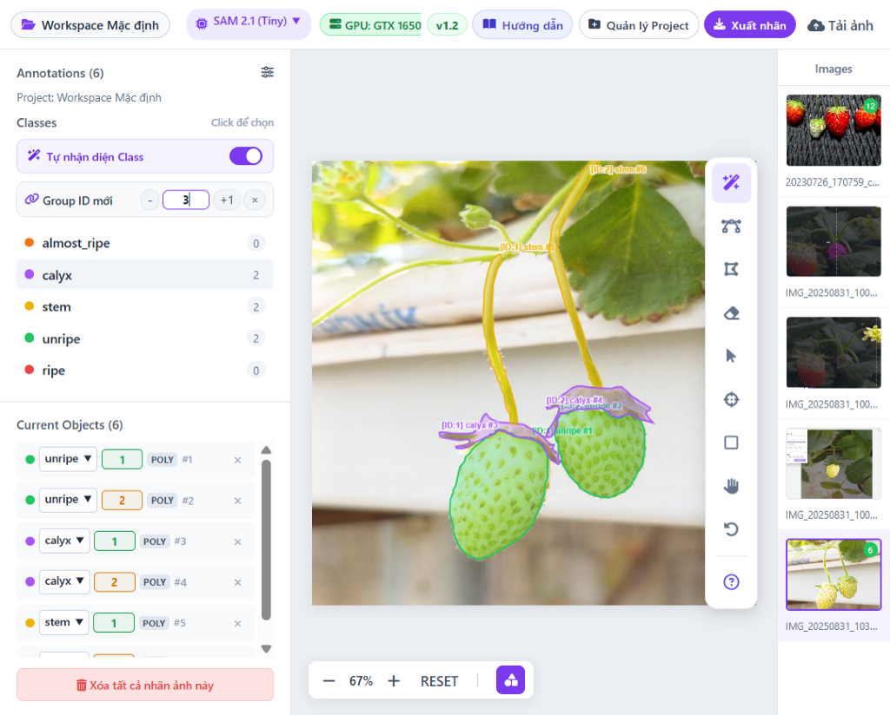
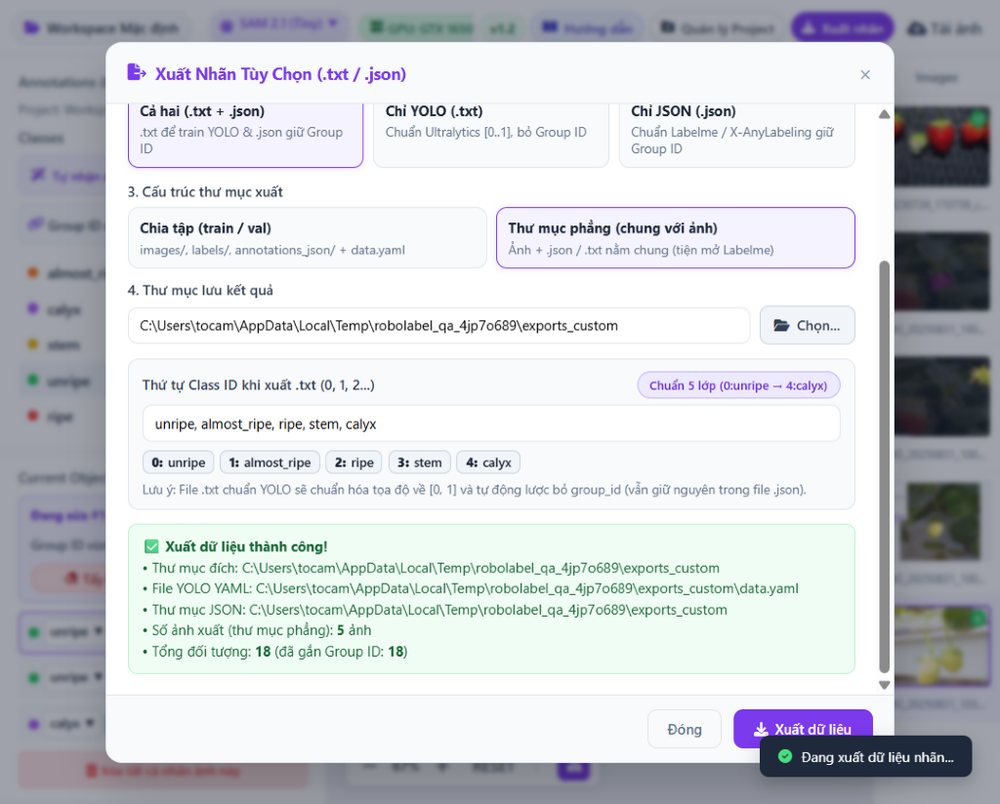

# RoboLabel AI — Studio Gán Nhãn & Phân Đoạn Ảnh Tự Động Cho YOLO

> **Phiên bản hiện tại:** `v1.2` — Hiển thị badge phiên bản trên Header & hỗ trợ tự động cập nhật 1-click qua `update.bat`.

Ứng dụng web chạy cục bộ giúp gán nhãn dữ liệu hình ảnh bán tự động cho **YOLO Instance Segmentation** (Polygon) và **YOLO Object Detection** (Bounding Box), tích hợp **SAM 2.1 (Segment Anything)**, **CLIP ViT-B/32** (tự động nhận dạng class), gán **`Group ID` theo từng vùng/cụm**, xuất nhãn tùy chọn sang **YOLO `.txt`** và **Labelme/X-AnyLabeling `.json`**, quản lý nhiều Dataset Project kèm **Auto-Save**, và công cụ **Chuyển đổi GPU/CPU + Benchmark GPU**.

---

## 1. Cấu hình Tối thiểu, Khuyến nghị & Yêu cầu phần mềm

### 1.1. Bảng cấu hình phần cứng (đối chiếu theo dung lượng thực tế & ngưỡng VRAM)

| Thành phần | Cấu hình Tối thiểu (Chạy được bằng CPU) | Cấu hình Khuyến nghị (Chạy mượt với GPU CUDA) |
| :--- | :--- | :--- |
| **Hệ điều hành** | Windows 10 / 11 (64-bit) | Windows 10 / 11 (64-bit) |
| **CPU** | Intel / AMD 64-bit, tối thiểu **4 luồng** (`~1.5s/vật thể` với SAM 2.1 Tiny trên CPU) | Intel Core i5/i7 (thế hệ 10+) hoặc AMD Ryzen 5/7 (**6–8 nhân / 12–16 luồng trở lên**) |
| **RAM** | **8 GB RAM** | **16 GB RAM trở lên** *(thoải mái cho ảnh độ phân giải lớn + SAM + CLIP + trình duyệt)* |
| **GPU & VRAM** | Không bắt buộc GPU rời *(hệ thống tự dùng CPU và tự lùi về CPU nếu GPU tràn VRAM)* | - Dùng **SAM 2.1 Tiny + CLIP**: GPU NVIDIA CUDA **≥ 4 GB VRAM** *(như GTX 1650, `~0.05s/vật thể`)*<br>- Dùng **SAM 2.1 Large (chi tiết cao)**: GPU NVIDIA CUDA **≥ 6 GB – 8 GB VRAM** *(RTX 2060 / 3060+)* |
| **Ổ cứng trống** | **8 – 10 GB trống** *(đã đo thực tế `venv` CUDA ~4.6 GB + weights mặc định ~412 MB)* | **15 – 20 GB+ SSD** *(dư cho cả SAM 2.1 Large ~428 MB, nhiều project & thư mục Export)* |
| **Trình duyệt** | Google Chrome / Microsoft Edge bản mới *(hỗ trợ HTML5 Canvas & chọn thư mục)* | Google Chrome / Microsoft Edge bản mới |
| **Mạng Internet** | Cần khi cài đặt lần đầu (`setup.bat` tải ~2.45 GB PyTorch CUDA + ~412 MB weights + gói thư viện) & khi chạy `update.bat` | Sau khi cài xong, toàn bộ thao tác gán nhãn **chạy offline cục bộ** |

### 1.2. Tài nguyên của từng mô hình AI tích hợp

| Mô hình | Dung lượng trọng số (`weights\`) | Ngưỡng VRAM ước tính | Ghi chú lựa chọn |
| :--- | :--- | :--- | :--- |
| **SAM 2.1 (Tiny)** — *Mặc định* | `~74.5 MB` (`sam2.1_t.pt`) | `~1.300 MB` *(cần ~1.9 GB trống để chạy dư dả)* | Tốc độ rất nhanh trên cả GPU 4 GB và CPU; khuyên dùng hằng ngày |
| **CLIP (ViT-B/32)** — *Tự nhận diện Class* | `~337.6 MB` (`clip\ViT-B-32.pt`) | `~950 MB` | Chỉ dùng khi bật công tắc **Tự nhận diện Class** |
| **SAM 2.1 (Large)** — *Tùy chọn* | `~428.4 MB` (`sam2.1_l.pt`) | `~3.600 MB` *(tự tải khi chọn lần đầu)* | Chi tiết cao hơn; với GPU 4 GB không nên bật liên tục nếu mở thêm CLIP/app đồ họa khác |

### 1.3. Phần mềm cần chuẩn bị trước

- **Python:** **3.10 – 3.14** ([python.org/downloads](https://www.python.org/downloads/)).
  > **Lưu ý quan trọng khi cài Python:** Ở màn hình cài đặt đầu tiên, bắt buộc tích chọn **`Add python.exe to PATH`** trước khi bấm *Install Now*.
- **Git for Windows:** Cần để tải dự án và dùng chức năng cập nhật tự động `update.bat`.
  - Cài nhanh qua PowerShell/CMD: `winget install --id Git.Git -e --source winget`
  - Hoặc tải bộ cài tại: [git-scm.com/download/win](https://git-scm.com/download/win) (các bước cài có thể giữ mặc định **Next**).
- **Driver NVIDIA (nếu máy có GPU NVIDIA):** Cài sẵn driver NVIDIA hỗ trợ CUDA `12.6` (hoặc `12.4`) để `setup.bat` tự kích hoạt PyTorch CUDA (`cu126`, dự phòng `cu124`). Sau khi mở app, có thể bấm **GPU / CPU** → **Chạy Benchmark GPU** để tự đo tốc độ thực tế và kiểm tra VRAM.

---

## 2. Cài đặt, Khởi chạy & Cập nhật

### Bước 1: Tải mã nguồn về máy
Mở **Command Prompt (`cmd`)** hoặc **PowerShell** tại thư mục muốn lưu ứng dụng (ví dụ `D:\`) và chạy:

```cmd
git clone https://github.com/tocamban/robolable_ai.git
cd robolable_ai
```

> **Khuyến nghị:** Dùng `git clone` thay vì bấm *Download ZIP* trên GitHub để giữ sẵn thư mục `.git` cho `update.bat`. *(Nếu lỡ tải bản ZIP, xem Mục 6 để liên kết lại `.git` mà không mất `venv/` hay `weights/`.)*

### Bước 2: Chạy cài đặt tự động 1-click (`setup.bat`)
Nhấp đúp vào **`setup.bat`**. Script sẽ tự động:
1. Tạo môi trường ảo **`venv\`** tách biệt.
2. Kiểm tra GPU NVIDIA (`nvidia-smi`) để cài **PyTorch CUDA `cu126`** (dự phòng `cu124`) hoặc tự chọn **PyTorch bản CPU**.
3. Cài đặt thư viện từ `requirements.txt` (`Flask`, `Ultralytics`, `OpenCV`, `Pillow`, `CLIP`, `psutil`, `nvidia-ml-py`,...).
4. Tải trọng số mặc định vào `weights\`: `sam2.1_t.pt` (~75 MB) và `clip\ViT-B-32.pt` (~338 MB).

Khi thấy thông báo **`CAI DAT HOAN TAT! BAN DA CO THE CHAY PROJECT!`**, nhấn phím bất kỳ để đóng.

### Bước 3: Điều khiển hằng ngày

| Thao tác | File thực thi | Mô tả chi tiết |
| :--- | :--- | :--- |
| **Khởi động app** | **`run_app.bat`** | Giải phóng port `5050` (nếu bị kẹt), khởi động server Flask và mở trình duyệt tại `http://127.0.0.1:5050`. *Giữ cửa sổ CMD mở trong suốt lúc làm việc để xem log AI.* |
| **Cập nhật bản mới** | **`update.bat`** | Tự tạm dừng port `5050`, kéo code mới từ GitHub (bảo toàn ảnh/project/`venv`/`weights`), tự cập nhật thư viện nếu `requirements.txt` thay đổi. |
| **Tắt server** | **`stop_server.bat`** | Dừng tiến trình trên port `5050` an toàn (hoặc bấm `Ctrl + C` trong cửa sổ terminal đang chạy). |

---

## 3. Tổng quan giao diện làm việc

Sau khi chạy `run_app.bat`, trình duyệt sẽ mở không gian làm việc chính gồm **4 khu vực**:



1. **Thanh Header (Phía trên):**
   - **Chọn Project:** Hiển thị Workspace / Project hiện tại (ví dụ `Workspace Mặc định`); click để mở nhanh danh sách Project.
   - **Chọn mô hình SAM:** Chuyển giữa **`SAM 2.1 (Tiny)`** (nhanh, khuyên dùng hằng ngày) và **`SAM 2.1 (Large)`** (viền chi tiết hơn).
   - **Nút `GPU / CPU`:** Xem thiết bị đang chạy (`GPU: GTX 165...` hoặc `CPU`), chuyển đổi CUDA/CPU và mở **Benchmark GPU**.
   - **Badge phiên bản (`v1.2`) & nút `Hướng dẫn` (`?` / `F1`):** Mở nhanh bảng hướng dẫn minh họa 5 tab ngay trong ứng dụng.
   - **`Quản lý Project` / `Xuất nhãn` / `Tải ảnh`:** Tạo hoặc mở Dataset Project, xuất nhãn tùy chọn (`.txt` / `.json`), và thêm ảnh đơn lẻ.
2. **Cột trái (Classes & Current Objects):**
   - Công tắc **`Tự nhận diện Class`** (bật để CLIP tự đoán nhãn khi cắt bằng AI; tắt để gán đúng Class đang chọn thủ công).
   - Thanh **`Group ID mới`** (`-`, ô nhập số / `Trống`, `+1`, `×`) đặt ID nhóm mặc định cho các vùng sắp vẽ.
   - Danh sách **Classes** & thống kê số nhãn trên ảnh hiện tại.
   - Danh sách **`Current Objects`** kèm ô chỉnh nhanh **`ID`** trên từng dòng và bảng thao tác đối tượng đang chọn (**`Tẩy bớt`**, **`+ Đắp thêm`**, **`Group ID vùng chọn`**).
3. **Vùng Canvas trung tâm & Thanh công cụ dọc:**
   - Thanh công cụ bên phải Canvas: **AI Smart Box (`S`)**, **AI Lasso**, **AI Point**, **Cục Tẩy (`E`)**, **Vẽ Polygon (`P`)**, **Bounding Box**, **Chọn & Kéo đỉnh (`V`)**, **Pan (`H`)**, **Hoàn tác (`Ctrl + Z`)**, và mở **Phím tắt (`?`)**.
   - Thanh dưới cùng Canvas: Thu/phóng **`- / 100% / + / RESET`** và nút bật/tắt **Mask** phủ màu bán trong suốt.
4. **Cột phải (`Images`):**
   - Dải thumbnail toàn bộ ảnh trong Project kèm huy hiệu số lượng nhãn trên từng ảnh để chuyển ảnh tức thì.

### Bảng Hướng dẫn trực quan tích hợp ngay trong app (`?` hoặc `F1`)

Bất kỳ lúc nào trong khi gán nhãn, bấm nút **`Hướng dẫn`** trên Header (hoặc phím **`?`** / **`F1`**) để mở hộp thoại 5 tab có sơ đồ minh họa từng thao tác (`Tổng quan`, `Công cụ AI`, `Sửa viền & Polygon`, `Group ID & Xuất nhãn`, `Quy trình & Phím tắt`):


---

## 4. Hướng dẫn chi tiết từng bước sử dụng

### 4.1. Tạo & Quản lý Dataset Project (Khuyên dùng)
Để không ghi đè lên thư mục ảnh gốc trên máy, nên tạo **Dataset Project** riêng:
1. **Cách 1 — Kéo thả trực tiếp:** Kéo cả thư mục chứa ảnh (hoặc Dataset YOLO Detection / Segmentation có sẵn nhãn) thả thẳng vào cửa sổ trình duyệt.
2. **Cách 2 — Qua nút `Quản lý Project`:** Chọn tab **Tạo Project Mới**, chọn thư mục nguồn từ ổ đĩa.
3. Hệ thống tự nhận diện loại dữ liệu (ảnh thuần / YOLO Box / YOLO Seg), cho phép chỉnh danh sách **Classes** (hoặc chọn bộ 5 lớp dâu tây mặc định: `almost_ripe`, `calyx`, `stem`, `unripe`, `ripe`), đặt **Tên Project** và **Thư mục lưu riêng**.
4. Dữ liệu được đồng bộ kèm file `robolabel_project.json` và **Auto-Save** mỗi khi vẽ, sửa hoặc gán `Group ID`.

### 4.2. Gán nhãn nhanh bằng AI (SAM 2.1 + CLIP)
- **AI Smart Box (`S`) — *Khuyên dùng*:** Giữ chuột trái kéo khung chữ nhật quanh vật thể → SAM 2.1 tự tách đường viền Polygon mượt (tự khử nhiễu, không nối bắc cầu các đảo nhỏ).
- **AI Lasso:** Giữ chuột khoanh vòng tự do quanh vật thể → hữu ích khi nhiều quả/lá nằm sát nhau, AI chỉ lấy mask bên trong vòng khoanh.
- **AI Point:** Click chọn Class ở cột trái (nếu tắt *Tự nhận diện Class*), sau đó click 1 điểm vào giữa vật thể để SAM tự khoanh viền.
- **Bounding Box thông thường:** Kéo khung chữ nhật YOLO Detection (4 đỉnh) không qua AI.

### 4.3. Vẽ thủ công & Tinh chỉnh viền Polygon
Khi AI tách bị lem ra ngoài hoặc cắt thiếu góc, bạn không cần xóa vẽ lại:
- **Cục Tẩy (`E`):** Chọn đối tượng cần sửa (click trực tiếp hoặc bấm **`Tẩy bớt`**), chỉnh kích thước đầu tẩy (`5px – 80px` bằng thanh trượt, nút `10 / 20 / 35 / 50px`, hoặc phím **`[`** / **`]`**) rồi giữ chuột trái quẹt gọt phần bị lem.
- **Vẽ Polygon Thủ Công / Đắp thêm (`P`):**
  - **Nếu ĐANG chọn sẵn 1 đối tượng** *(hiện nhãn Đắp thêm vào Object đang chọn)*: chấm các đỉnh bao vùng bị thiếu rồi đóng kín → hệ thống tự **gộp (Union)** vào polygon cũ.
  - **Nếu CHƯA chọn đối tượng nào** *(bấm `Bỏ chọn` nếu muốn tạo mới)*: click đặt từng đỉnh quanh vật thể, đưa chuột lại gần điểm đầu tiên (xuất hiện vòng xanh **Snap**) rồi nhấn **`Enter`** hoặc **Double-click** để khép kín. Nhấn **Chuột phải** / **`Backspace`** / **`Delete`** để xóa đỉnh vừa đặt; **`Esc`** để hủy.
- **Chọn & Kéo đỉnh (`V`):** Click chọn đối tượng để hiện các chấm đỉnh trên viền, kéo thả từng đỉnh tới đúng vị trí (tự lưu ngay khi thả chuột).
- **Pan (`H` hoặc giữ chuột giữa) & Zoom:** Cuộn con lăn chuột để phóng to/thu nhỏ tại vị trí con trỏ; nhấn **`Ctrl + Z`** để hoàn tác tối đa **30 bước**.

### 4.4. Bảng phím tắt nhanh

| Phím / Thao tác | Chức năng |
| :--- | :--- |
| **`S`** | Chọn công cụ **AI Smart Box** |
| **`P`** | Chọn **Vẽ Polygon Thủ Công** (hoặc **Đắp thêm** nếu đang chọn object) |
| **`E`** | Chọn **Cục Tẩy Polygon** |
| **`[`** / **`]`** | Giảm / Tăng kích thước Cục Tẩy (±5px) |
| **`V`** | Chọn chế độ **Chọn & Kéo đỉnh Polygon** |
| **`H`** hoặc **Giữ chuột giữa** | Chế độ **Bàn tay (Pan)** kéo di chuyển ảnh |
| **Cuộn con lăn chuột** | Phóng to / Thu nhỏ ảnh tại con trỏ |
| **`Enter`** | Hoàn tất Polygon thủ công đang vẽ (tối thiểu 3 đỉnh) |
| **Chuột phải** / **`Backspace`** / **`Delete`** | Xóa đỉnh vừa đặt khi đang vẽ Polygon thủ công |
| **`Ctrl + Z`** | Hoàn tác (Undo) thao tác gần nhất |
| **`?`** hoặc **`F1`** | Mở bảng **Hướng dẫn sử dụng** (`Esc` để đóng) |

---

### 4.5. Hướng dẫn đánh `Group ID` theo từng vùng/cụm

Khi một cụm đối tượng gồm nhiều bộ phận tách rời thuộc chung một thực thể — ví dụ mỗi quả dâu gồm **thịt quả** (`unripe` / `almost_ripe` / `ripe`), **đài hoa** (`calyx`) và **cuống** (`stem`) — bạn dùng **`Group ID`** để liên kết chúng lại:


1. **Đánh ID trước khi vẽ *(nhanh nhất)*:**
   - Tại thanh **`Group ID mới`** ở cột trái, gõ số `1` (hoặc bấm `+1`) rồi lần lượt vẽ **thịt quả**, **đài hoa** và **cuống** của quả thứ nhất. Mọi vùng mới tạo (bằng SAM AI, Polygon thủ công hay BBox) đều tự gắn `[ID:1]`.
   - Khi chuyển sang quả bên cạnh, bấm nút **`+1`** để tăng `Group ID mới` lên `2` và vẽ tiếp cụm thứ hai (`[ID:2]`). Bấm **`×`** để quay lại trạng thái `Trống` (không gắn ID tự động).
2. **Sửa ID & kiểm tra viền đồng bộ:**
   - Gõ trực tiếp số vào ô **`ID`** trên từng dòng của **`Current Objects`**, hoặc chọn đối tượng rồi sửa trong **`Group ID vùng chọn`** (`×` để xóa ID).
   - Khi click chọn một vùng (như **`#1 (unripe)`** màu tím ở ảnh minh họa trên), các bộ phận khác cùng `ID: 1` (như **`[ID:1] calyx #3`** và **`[ID:1] stem #5`**) tự động hiện **viền đứt nét cùng màu** trên Canvas để bạn rà soát tức thì việc ghép cụm có bị nhầm sang quả `ID: 2` hay không.
3. **Trường hợp đặc biệt — Cuống bị lá che đứt làm 2 đoạn:**
   - **Tuyệt đối không vẽ nối xuyên qua chiếc lá.**
   - Nếu đang chọn đoạn cuống thứ nhất mà muốn vẽ đoạn rời thứ hai bằng công cụ `P`, hãy bấm **`Bỏ chọn`** (để không bị gộp Union thành một khối), giữ nguyên `Group ID mới = 1`, chọn lớp `stem` rồi vẽ **polygon thứ hai** — cả hai đoạn đều giữ nhãn `stem` và `"group_id": 1`.
   - Nếu bạn dùng **Cục tẩy (`E`)** quẹt ngang phần lá đè lên cuống để tách polygon thành 2 mảnh rời, phần mềm cũng **tự động giữ nguyên `group_id`** cho các mảnh con.

---

### 4.6. Auto-Save & Xuất nhãn tùy chọn (`.txt` / `.json`)

- **Auto-Save:** Mọi thay đổi đều tự lưu ngay vào `annotations/<tên_ảnh>.json` (giữ `group_id`) và đồng bộ file `.txt` của Workspace/Project.
- **Mở hộp thoại Xuất nhãn tùy chọn:** Bấm nút **`Xuất nhãn`** ở góc trên bên phải Header để tùy chỉnh toàn bộ cách xuất dữ liệu:



1. **Phạm vi xuất:**
   - **Toàn bộ Project:** Xuất toàn bộ ảnh và file nhãn sang một thư mục trên máy (bấm **`Chọn...`** để chọn thư mục; hệ thống tự chặn ghi đè lên thư mục ảnh gốc hoặc thư mục hệ thống).
   - **Chỉ ảnh hiện tại:** Tải trực tiếp file `<tên>.json`, `<tên>.txt`, hoặc gói `<tên>_labels.zip` (gồm `.json`, `.txt`, `classes.txt`).
2. **Định dạng file nhãn:**
   - **Cả hai (`.txt + .json`):** Xuất đồng thời file `.txt` để train YOLO và file `.json` giữ nguyên `group_id` để chạy script đánh giá ghép cặp.
   - **Chỉ YOLO (`.txt`):** Chuẩn hóa tọa độ về `[0, 1]` theo chuẩn Ultralytics YOLO-Seg và **tự động lược bỏ `group_id`**.
   - **Chỉ JSON (`.json`):** Xuất theo chuẩn **Labelme / X-AnyLabeling** (tọa độ pixel tuyệt đối) và **giữ nguyên `"group_id"`**.
3. **Cấu trúc thư mục (khi xuất cả Project):**
   - **Chia tập (`train / val`):** Tổ chức thành `images/`, `labels/`, `annotations_json/` kèm `data.yaml` và `classes.txt` (giữ chia tập có sẵn hoặc tự chia `80% train / 20% val`).
   - **Thư mục phẳng (chung với ảnh):** Đặt ảnh, `.json` và `.txt` nằm chung trong một thư mục — tiện mở trực tiếp trên Labelme hoặc X-AnyLabeling.
4. **Thứ tự Class ID khi xuất `.txt`:**
   - Mặc định dùng danh sách class của Project đang mở, hoặc tự sắp xếp lại danh sách tên lớp.
   - Nếu Project có đủ 5 lớp dâu tây, bấm nút **`Chuẩn 5 lớp (0:unripe → 4:calyx)`** để ép thứ tự chuẩn: `0: unripe`, `1: almost_ripe`, `2: ripe`, `3: stem`, `4: calyx`.

#### Ví dụ dữ liệu xuất thực tế (ảnh `1000 × 1000` px, `group_id = 1`)

File gốc **`anh_01.json`** (giữ tọa độ pixel tuyệt đối và `"group_id"`):
```json
{
  "imagePath": "anh_01.jpg",
  "imageWidth": 1000,
  "imageHeight": 1000,
  "shapes": [
    {
      "label": "ripe",
      "group_id": 1,
      "shape_type": "polygon",
      "points": [[420, 520], [580, 520], [590, 750], [500, 800], [410, 750]]
    },
    {
      "label": "calyx",
      "group_id": 1,
      "shape_type": "polygon",
      "points": [[440, 500], [500, 480], [560, 500], [540, 520], [460, 520]]
    },
    {
      "label": "stem",
      "group_id": 1,
      "shape_type": "polygon",
      "points": [[495, 480], [505, 480], [508, 350], [498, 350]]
    }
  ]
}
```

File huấn luyện YOLO-Seg **`anh_01.txt`** (quy đổi theo `Chuẩn 5 lớp`, chuẩn hóa `[0, 1]` và lược bỏ `group_id`):
```text
2 0.420000 0.520000 0.580000 0.520000 0.590000 0.750000 0.500000 0.800000 0.410000 0.750000
4 0.440000 0.500000 0.500000 0.480000 0.560000 0.500000 0.540000 0.520000 0.460000 0.520000
3 0.495000 0.480000 0.505000 0.480000 0.508000 0.350000 0.498000 0.350000
```
*(Nếu `stem` bị lá che tách làm 2 polygon đều mang `group_id = 1`, file `.json` giữ nguyên 2 shape với `"group_id": 1`, còn file `.txt` xuất thành 2 dòng độc lập bắt đầu bằng số `3`.)*

---

## 5. Cấu trúc thư mục dự án

```text
robolabel_app/
├── app.py                  # Server Flask backend, AI SAM 2.1, CLIP & API xuất nhãn
├── project_manager.py      # Quản lý Dataset Project, auto-detect YOLO, Group ID & auto-save
├── device_manager.py       # Quản lý CPU / GPU CUDA & Benchmark phần cứng
├── static/
│   └── index.html          # Giao diện Canvas HTML5/JS + Modal Hướng dẫn trực quan
├── docs/
│   └── images/             # Ảnh chụp màn hình minh họa cho README.md
├── tests/
│   └── self_check.py       # Bộ tự kiểm tra hồi quy backend, Group ID & export
├── uploads/                # Ảnh workspace mặc định
├── annotations/            # File .json & .txt nhãn tương ứng workspace mặc định
├── weights/                # Thư mục lưu trọng số AI (SAM 2.1 & CLIP - tự tải bởi setup.bat)
├── requirements.txt        # Danh sách thư viện Python
├── setup.bat               # Tự động tạo venv, cài CUDA/CPU PyTorch & tải model AI
├── run_app.bat             # Khởi động server (port 5050) và mở trình duyệt
├── update.bat              # 1-click kéo bản cập nhật mới nhất từ GitHub
├── stop_server.bat         # Tắt server & giải phóng port 5050
├── stop_server.ps1         # Script PowerShell dừng tiến trình trên port 5050
└── push_to_github.bat      # Hỗ trợ đóng gói & đẩy mã nguồn lên GitHub
```

*(Các thư mục nặng như `venv/` và file trọng số `weights/*.pt` được loại trừ trong `.gitignore` để giữ repository nhẹ và không vượt quá giới hạn 100 MB của GitHub.)*

---

## 6. Xử lý các lỗi thường gặp

1. **`update.bat` báo `[!] Thu muc nay khong chua lich su Git (.git)!`**
   - **Nguyên nhân:** Thư mục trên máy được tải bằng *Download ZIP* hoặc copy thủ công thiếu `.git`.
   - **Cách khắc phục giữ nguyên `venv/`, `weights/` và dữ liệu đã gán nhãn:** Mở `cmd` ngay trong thư mục dự án và chạy lần lượt:
     ```cmd
     git init
     git checkout -B main
     git remote add origin https://github.com/tocamban/robolable_ai.git
     git fetch origin main
     git reset --mixed origin/main
     git checkout -- .
     ```
     Sau đó nhấp đúp `update.bat` sẽ hoạt động bình thường.
2. **Chạy `setup.bat` báo không tìm thấy Python:**
   - Cài lại Python 3.10–3.14 và nhớ tích **`Add python.exe to PATH`** rồi mở lại `setup.bat`.
3. **Máy có GPU NVIDIA nhưng app báo chạy `CPU`:**
   - Bấm vào nút **GPU / CPU** trên Header để chuyển sang **Chạy bằng GPU (CUDA)**; nếu hộp thoại báo *venv đang cài PyTorch bản CPU*, chạy lại **`setup.bat`** (hoặc chạy lệnh cài PyTorch `cu126` hiển thị trong hộp thoại) rồi khởi động lại ứng dụng.
4. **Lỗi không mở được `http://127.0.0.1:5050` hoặc kẹt port:**
   - Chạy **`stop_server.bat`** để dọn tiến trình cũ trên port `5050`, sau đó mở lại bằng **`run_app.bat`**.

---

## 7. Đóng gói & Đẩy thay đổi lên GitHub (Dành cho người phát triển)

1. Cài đặt [Git for Windows](https://git-scm.com/download/win).
2. Nhấp đúp **`push_to_github.bat`**, nhập URL repository `.git` (nếu là repo mới) và xác nhận commit để push lên nhánh `main`.
